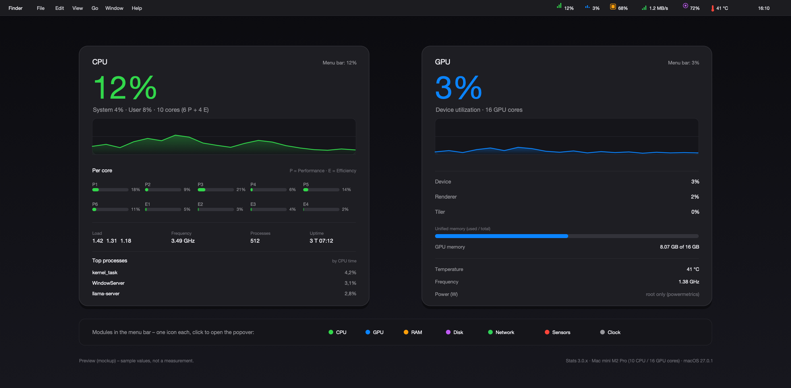

# macos-stats

*CPU, GPU, memory, network, disk and sensor readouts as menu bar modules on the Mac mini – installer, setup, verification and rollback in one place.*

[Stats](https://github.com/exelban/stats) is an open-source menu bar app (MIT). This repository bundles the verified installation image, the module setup and the documentation needed on the device. It is **not a fork** and contains no code from the app.

## Contents

| Path | Purpose |
|---|---|
| `dist/stats-3.0.23.dmg` | Official release image, unmodified, SHA-256 verified |
| `install.sh` | Verify the image, install the app, enable modules, start it |
| `uninstall.sh` | Remove app, preferences and program data |
| `docs/module-keys.md` | Module keys inside `eu.exelban.Stats` |
| `docs/upstream.md` | Provenance of the vendored source tree |
| `upstream/` | Unmodified source of `v3.0.23` (Swift, MIT) |
| `assets/` | Menu bar preview (SVG source + PNG) |



## Install

```bash
git clone https://github.com/alkipp/macos-stats.git
cd macos-stats
./install.sh
```

The script needs **no sudo** and checks the SHA-256 of the image before mounting it. It quits a running instance, copies `Stats.app` to `/Applications`, writes the module keys and restarts the app.

Requirements: macOS 12 or newer, Apple Silicon, about 10 MB of disk space.

> Note: since macOS 26 `hdiutil attach` warns that it is deprecated. The script keeps using it because it works reliably from macOS 12 through 27; the warning is harmless.

## Modules

After installation every module has its own menu bar icon; a click opens the popover with history and details.

| Module | Menu bar | Popover |
|---|---|---|
| CPU | line chart + percent | total, system/user, per-core bars, top processes |
| GPU | mini chart | device/renderer/tiler, GPU memory, temperature |
| RAM | bar + percent | memory pressure, used/free, swap |
| Disk | bar + percent | usage, reads/writes per second |
| Network | throughput | down/up rate, history, interface |
| Sensors | value | temperatures, fan speed |
| Clock | time | date and time |

Key details: [`docs/module-keys.md`](docs/module-keys.md).

## Verify

```bash
spctl -a -vvv /Applications/Stats.app   # Notarized Developer ID, team RP2S87B72W
defaults read /Applications/Stats.app/Contents/Info.plist CFBundleShortVersionString
pgrep -x Stats
defaults read eu.exelban.Stats | grep _state
```

The last command must show `<Module>_state = 1` for every module you want. If the app additionally writes `<Module>_widget`, the module is loaded.

## Uninstall

```bash
./uninstall.sh
```

## Limits

- **Power per block** (CPU/GPU/ANE) and **ANE utilization** are not available – those need `powermetrics` as root.
- **Fan control** requires the app's SMC helper; only reading is configured here.
- **Persistent history** does not exist; graphs live in the popover only. For time series, use an exporter feeding Prometheus.

## Origin and license

The app is written by Serhiy Mytrovtsiy and licensed under MIT; the image is the unmodified `v3.0.23` release. The source tree in [`upstream/`](upstream/) is the same tag, exported with `git archive`; provenance is documented in [`docs/upstream.md`](docs/upstream.md). The fork used for upstream work lives at <https://github.com/alkipp/stats>.

See [`THIRD-PARTY.md`](THIRD-PARTY.md) and [`LICENSE`](LICENSE) for the scripts and docs of this repository.

## Security

Report vulnerabilities privately via GitHub: <https://github.com/alkipp/macos-stats/security/advisories/new>. Details and the status of known advisories are in [`SECURITY.md`](SECURITY.md).

## Maintainer

Alexander Kippar – <https://github.com/alkipp>. Source work lives in the fork <https://github.com/alkipp/stats>.
